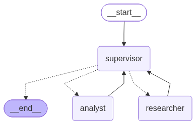

# Entrega 6: Orquestador Multi-Agente de Análisis e Investigación con RAG

Este proyecto implementa un **Orquestador Multi-Agente de Análisis e Investigación** utilizando **LangGraph** y un sistema de recuperación semántica local (**RAG con ChromaDB y HuggingFace Embeddings**).

El sistema cuenta con una arquitectura jerárquica gobernada por un nodo **Supervisor** que actúa como router inteligente y controlador de flujo, delegando tareas de forma dinámica a sub-agentes especialistas en investigación y análisis/síntesis.

---

## 📐 Topología del Grafo

El flujo del sistema se basa en el **Patrón Supervisor (Supervisor Pattern)** con estado compartido estructurado (`MultiAgentState`).

### Diagrama Mermaid del Grafo

```mermaid
graph TD
    START([Inicio / Usuario]) --> Supervisor[Supervisor / Router]
    
    Supervisor -- decision == "researcher" --> Researcher[Agente Investigador]
    Supervisor -- decision == "analyst" --> Analyst[Agente Analista / Sintetizador]
    Supervisor -- decision == "FINISH" --> END([Fin / Respuesta Final])
    
    Researcher -- Búsqueda RAG finalizada --> Supervisor
    Analyst -- Síntesis y Traducción finalizada --> Supervisor
```



### Explicación de la Topología Elegida

1. **Nodo Supervisor (Router Inteligente)**:
   - Utiliza **Salida Estructurada (`Structured Output` con Pydantic)** para garantizar decisiones probabilísticas seguras (`researcher`, `analyst`, o `FINISH`).
   - Evalúa el historial de la conversación y decide cuál especialista debe actuar o si la tarea se ha completado.
   - Cuenta con un contador de iteraciones y límites para **prevenir bucles infinitos**.

2. **Agente Investigador (`researcher`)**:
   - Posee en exclusiva la herramienta `buscar_en_vectorstore` (Aislamiento de Herramientas).
   - Realiza consultas en **Español** sobre la base de datos vectorial ChromaDB que contiene la documentación histórica de `./data`.
   - Genera reportes objetivos etiquetados con atribución clara (`name="investigador"`).

3. **Agente Analista / Sintetizador (`analyst`)**:
   - Recibe la evidencia recopilada por el investigador y la procesa.
   - Redacta la respuesta final **exclusivamente en el `idioma_destino`** configurado en el estado compartible (por ejemplo, Español, Francés, Inglés), permitiendo la separación entre el idioma de almacenamiento/búsqueda y el idioma de entrega al usuario.
   - Cuenta con reglas de **grounding estricto (cero alucinaciones)** para evitar respuestas de cultura general cuando los documentos no contienen la información.

---

## 🔭 Observabilidad con Arize Phoenix y OpenInference

El proyecto incluye integración nativa con **Arize Phoenix** a través del estándar OpenInference / OpenTelemetry (`tracing.py`).

### Configurar e iniciar Arize Phoenix

1. **Iniciar el servidor local de Arize Phoenix**:
```bash
# Con el entorno virtual activado:
phoenix serve
```
El servidor de Arize Phoenix iniciará su UI en `http://localhost:6006`.

2. **Variables de entorno en `.env`**:
```ini
PHOENIX_COLLECTOR_ENDPOINT=http://localhost:6006/v1/traces
PHOENIX_PROJECT_NAME=orquestador-multi-agente
```

Toda ejecución realizada a través de `main.py` o `demo.ipynb` enviará automáticamente las trazas de ejecución de LangChain (Llamadas a LLM, RAG y Agentes) directamente a tu interfaz de Phoenix para su análisis de latencia, costo y evaluación de respuestas.

---

## ⚙️ Configuración Multi-Proveedor de LLM (Gemini / Groq)

El sistema permite seleccionar dinámicamente el proveedor de LLM a través de la variable `LLM_PROVIDER` en el archivo `.env`:

```ini
# Selección de proveedor: "gemini" o "groq"
LLM_PROVIDER=gemini

# Para usar Google Gemini
GEMINI_API_KEY=tu_gemini_api_key
GEMINI_MODEL_NAME=gemini-3-flash-preview

# Para usar Groq
GROQ_API_KEY=tu_groq_api_key
GROQ_MODEL_NAME=llama-3.3-70b-versatile

# Token opcional de HuggingFace Hub (para evitar límites de descarga de embeddings)
HF_TOKEN=tu_token_aqui_hf_
```

Para cambiar de proveedor, simplemente cambia `LLM_PROVIDER=groq` o `LLM_PROVIDER=gemini` en tu archivo `.env`.

---

## 🛠️ Requisitos Previos e Instalación

### 1. Clonar el repositorio e instalar dependencias con `uv`

Este proyecto utiliza **`uv`** como gestor de entornos y dependencias rápido.

```bash
# Crear el entorno virtual con uv
uv venv .venv

# Activar el entorno virtual
# En Linux/macOS:
source .venv/bin/activate
# En Windows (PowerShell / CMD):
.venv\Scripts\activate

# Instalar dependencias
uv pip install -r requirements.txt
```

---

## 🚀 Ejecución

### Ejecución de Scripts e Ingesta

El sistema verifica automáticamente si la Vector DB existe en `./vectorstore`. Si no existe, realiza la ingesta de forma automática desde `./data`.

Puedes ejecutar los scripts según tu sistema operativo o preferencia:

**Opción A: Ejecución estándar (con el entorno virtual activado):**
```bash
python ingest.py
python main.py
```

**Opción B: En Windows (especificando el ejecutable del entorno venv):**
```cmd
.venv\Scripts\python.exe ingest.py
.venv\Scripts\python.exe main.py
```

**Opción C: Usando `uv` (multiplataforma):**
```bash
uv run ingest.py
uv run main.py
```

El script `main.py` ejecutará 3 pruebas representativas:
1. Consulta sobre la historia del Karate Uechi-Ryu (Respuesta en Español).
2. Consulta sobre katas traídas de China (Respuesta en Francés).
3. Pregunta trampa sobre historia de EE.UU. no contenida en los documentos (Respuesta controlada "No dispongo de esa información").

---

## 📓 Demostración interactiva (Jupyter Notebook)

Se incluye el archivo **`demo.ipynb`** que muestra el flujo de delegación nodo por nodo, las llamadas a las herramientas y los logs del sistema.

Para iniciarlo:
```bash
# Con entorno activado
jupyter notebook demo.ipynb

# O con uv:
uv run jupyter notebook demo.ipynb
```

---

## 📝 Sistema de Logging y Trazabilidad

Los eventos del sistema se registran de forma aislada en la carpeta `./log`:
- **`log/agentes.log`**: Registra las decisiones del Supervisor, ruteo y ejecuciones de los agentes especialistas.
- **`log/rag.log`**: Registra la ingesta de documentos, chunking, embeddings y búsquedas vectoriales sobre ChromaDB.

---

## 🛡️ Criterios de Calidad y Buenas Prácticas Aplicadas

- **Structured Output**: Control estricto de decisiones del Supervisor con esquemas Pydantic.
- **Atribución de Mensajes (`name`)**: Identificación clara de respuestas por agente (`investigador`, `analista`).
- **Aislamiento de Herramientas y Estado**: Sub-agentes encapsulados que previenen contaminación de contexto (`context bloating`).
- **Manejo Elegante de Excepciones**: Captura de errores de API (ej. `429 RESOURCE_EXHAUSTED`) con logs detallados e informe limpio al usuario.
- **Observabilidad OTLP**: Integración con Arize Phoenix vía OpenInference.
- **Ejecución Asíncrona Streaming (`astream`)**: Procesamiento asíncrono no bloqueante para seguimiento nodo a nodo.
